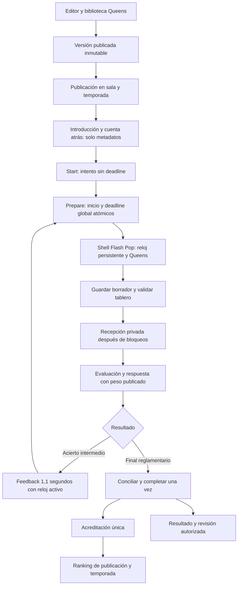

# Contrarreloj

Estado: vigente para la primera versión competitiva Queens.

Última actualización: 2026-10-11. Identificador técnico: `time-trial`.

## Propósito y alcance

Resolver una secuencia fija de pruebas Queens antes de agotar un único reloj global. Cada tablero
resuelto concede su peso editorial completo y abre el siguiente. La primera versión admite entre
2 y 20 pruebas Queens de 4×4 a 8×8. Escape, Conectar parejas, Mini-Wordle y Hashtag quedan fuera
hasta verificar sus combinaciones de modo y formato.

Las [decisiones normativas](../../decisions/decisions.md#21-contrarreloj-reglas-acordadas), los
[contratos comunes](mode-contracts.md#reglas-comunes), el
[ADR de recuperación](../../decisions/adr/0003-attempt-lifecycle-and-concurrency.md) y el
[ADR de transferencia](../../decisions/adr/0006-explicit-attempt-control-transfer.md) prevalecen.
Las decisiones CT-01 a CT-05 están cerradas para esta versión; la
[guía editorial](../../content/guidelines/contrarreloj.md) define la calibración previa a publicar.

## Contenido, puntuación y oportunidades

Todos reciben las mismas versiones, el mismo orden y la misma duración. La dificultad debe crecer
por complejidad observada; puede aumentar reduciendo pistas sin cambiar el tamaño del tablero.
La duración es obligatoria, sin valor inicial: segundos enteros positivos, guardados en
`global_time_limit_ms`. El máximo representable es 2.147.483 segundos completos.

Cada prueba tiene un peso editorial entero positivo. Los pesos suman exactamente 100; reordenar
conserva el peso y guardar nunca redistribuye puntos. Un acierto concede todo el peso. No hay
crédito parcial, bonus por velocidad ni penalización de puntos por validaciones incorrectas.
Los tiempos individuales publicados en las preguntas no tienen efecto competitivo en este modo.

Dos validaciones completas incorrectas permiten continuar en ese tablero; la tercera termina la
partida. El contador se reinicia al avanzar. Las ediciones exploratorias y las solicitudes
inválidas, incompletas o repetidas con la misma clave no consumen oportunidades.

## Reloj y finalización

La introducción solo entrega metadatos y precarga controles. No crea intento ni libera tablero.
Tras los tres segundos de cuenta atrás, `start` valida la publicación y crea o recupera el intento
con `deadline_at = null`. La primera preparación crea atómicamente su unidad temporal, el deadline
y el intervalo antes de entregar el primer tablero. `started_at` conserva la fecha de creación;
el inicio competitivo se deriva de `deadline_at − global_time_limit_ms`.

Cada prueba tiene su intervalo y unidad temporal, con el mismo deadline global. La sesión conserva
ese vencimiento. El reloj corre durante validaciones, cargas y transiciones, sin compensaciones.
La transición de acierto dura 1,1 segundos; el último acierto solicita el cierre inmediatamente.

La recepción se fecha en PostgreSQL después de adquirir los bloqueos. Solo es válida si sucede
**antes** del deadline; la igualdad queda fuera. El cierre concilia primero cualquier recepción
pendiente. Una recepción aceptada a tiempo mantiene sus puntos aunque se evalúe después del límite:

| Hecho conciliado                                               | Motivo de cierre       |
| -------------------------------------------------------------- | ---------------------- |
| Resuelve la última prueba                                      | `all_solved`           |
| Tercera validación completa incorrecta                         | `validation_limit`     |
| Acierto intermedio y reloj ya vencido                          | `time_limit`           |
| Prueba activa sin recepción final, recuperada antes del límite | `recovery_interrupted` |
| Reloj vencido al recuperar sin recepción                       | `time_limit`           |

Los cierres reglamentarios persisten `completed`, `outcome = null` y conservan los puntos anteriores.
Abandono y pérdida de permisos siguen las reglas comunes y no acreditan puntos. Finalización,
evaluación y ledger son idempotentes. No se fabrican respuestas o tiempos para pruebas no entregadas.

## Recuperación

Una recepción existente se concilia primero. Si una prueba activa carece de recepción final, se
cierra sin respuesta y termina el desafío; un borrador guardado, incluso completo, no sustituye una
validación recibida. No se reentrega una prueba vista. La transferencia de control aplica la misma
regla y conserva el intento y deadline originales.

Un intento creado sin tablero puede recibir su primera prueba. Recuperar entre pruebas, sin una
interacción abierta ni recepción pendiente, permite preparar la siguiente si el reloj sigue vivo.
Recargar y perder una confirmación nunca crea un nuevo reloj ni una segunda acreditación.

## Rankings y revisión

El comparador central de publicación e historial ordena por pruebas resueltas descendente y luego
milisegundos globales hasta el último acierto ascendente. La métrica procede de las recepciones
aceptadas e incluye las transiciones. No incluye el tiempo del fallo final. Los empates comparten
posición (`1, 1, 3`); todos los jugadores sin aciertos empatan sin tiempo de último acierto.
El identificador del jugador estabiliza únicamente el orden visual. La temporada sigue sumando
Flash Points y no cambia su comparador.

La revisión distingue pruebas resueltas, entregadas sin resolver y no alcanzadas. Las últimas
muestran orden, formato y peso, sin tablero ni solución. Las consultas de resultado propio siguen
requiriendo autorización; las soluciones nunca aparecen durante el juego.

## Recorrido E2E

Se reutilizan versiones, publicaciones, intentos, sesiones, unidades temporales, intervalos,
recepciones, respuestas y ledger; no se añaden tablas. `private.time_trial_progress` deriva el
progreso separado de Queens. `get_my_time_trial_challenge` entrega metadatos y
`get_my_time_trial_result` entrega el resultado propio y revisión protegida. El dispatcher común,
los comandos competitivos y las rutas HTTP existentes integran el modo.

La UI reutiliza `ChallengeIntro`, `StartCountdown`, `FlashPopGameShell`, `ServerQueensQuestion`,
`Timer`, avisos de sesión, resultados y revisión. El reloj permanece montado durante la prueba,
validación, transición y preparación. Los controles desaparecen durante la confirmación final.
El resultado muestra puntos, resueltas/total, tiempo hasta el último acierto o «Sin aciertos» y motivo.

## Integración y publicación

La migración incremental conserva el historial aplicado y los cinco modos anteriores. Desplegar
primero la migración compatible y después la aplicación. Las suites SQL, unitarias, integración
Supabase y E2E aisladas cubren reglas, permisos y regresiones; la evidencia de cada ejecución se
registra en [estado del proyecto](../status.md).

Antes de habilitar publicaciones reales, resolver una secuencia Queens calibrada en staging,
comprobar móvil/escritorio y revisión, y verificar soluciones, pistas, progresión y duración. Los
fixtures de pruebas validan contratos técnicos y no constituyen contenido editorial calibrado.
