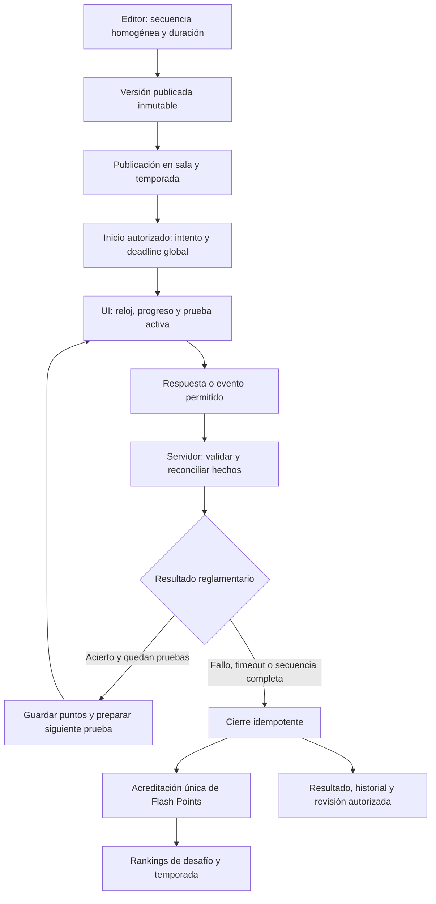

> Estado: propuesta de diseño previo a implementación. Las reglas marcadas como acordadas están
> aprobadas; la fórmula y los detalles pendientes siguen abiertos. El modo todavía no está implementado.

# Contrarreloj

Última actualización: 2026-10-11.

## Propósito y fuentes

Contrarreloj propone resolver una secuencia de pruebas de lógica o razonamiento, de dificultad
creciente, antes de agotar un único reloj global. Cada acierto suma Flash Points y permite avanzar;
un fallo definitivo termina la partida. La comparación principal es cuántas pruebas consigue resolver
cada jugador.

Las [reglas aprobadas del modo](../../decisions/decisions.md#21-contrarreloj-reglas-acordadas)
prevalecen sobre las propuestas de este documento. También se aplican los
[contratos comunes](mode-contracts.md#reglas-comunes) y los ADR vigentes. Las
[decisiones pendientes](../../decisions/open-questions.md#contrarreloj-decisiones-pendientes)
deben cerrarse antes de implementar las capacidades afectadas. La
[guía editorial](../../content/guidelines/contrarreloj.md) explica cómo preparar el contenido.

Esta especificación describe comportamiento esperado y cambios previstos. No aprueba un identificador
técnico del modo, firmas de endpoints, payloads ni una migración concreta.

## Identidad y diferencia respecto a Flash

El nombre del modo existente es **Flash**. **Contrarreloj** identifica este modo nuevo y separado.
Un desafío de Contrarreloj contiene una secuencia finita, curada y ordenada de un único formato;
todos sus participantes reciben las mismas versiones de pruebas y el mismo orden. La dificultad
aumenta por complejidad real, aunque dos pruebas consecutivas tengan el mismo tamaño de tablero.

| Aspecto             | Flash actual                                                                | Contrarreloj acordado, pendiente de implementar                       |
| ------------------- | --------------------------------------------------------------------------- | --------------------------------------------------------------------- |
| Tiempo              | Un límite por pregunta.                                                     | Un límite global para toda la partida.                                |
| Contenido           | Puede combinar formatos.                                                    | Mantiene el mismo formato en todas las pruebas.                       |
| Progresión          | Recorre la secuencia, incluso tras respuestas incorrectas o no contestadas. | Avanza al resolver; termina ante un fallo definitivo.                 |
| Final               | Al terminar la secuencia.                                                   | Por fallo definitivo, reloj agotado o todas las pruebas resueltas.    |
| Ranking del desafío | Comparador común de los cinco modos actuales.                               | Más pruebas resueltas; después, menor tiempo hasta el último acierto. |

Queens, Escape, Conectar parejas, Mini-Wordle y Hashtag de palabras son candidatos adecuados. Que un
formato exista en práctica o en otro modo no habilita automáticamente su uso competitivo en
Contrarreloj: debe verificarse su combinación específica de reglas, servidor, editor y UI.

## Partida y tiempo: reglas acordadas

1. La introducción explica el formato, el tiempo total y qué constituye un fallo definitivo.
   Consultarla no consume el intento. Se aplica la cuenta atrás del recorrido competitivo.
2. Al comenzar la primera prueba se inicia el reloj global. El servidor confirma el inicio y el
   deadline del intento; el cliente presenta el tiempo restante. El protocolo exacto de disponibilidad
   de la primera prueba está pendiente, para evitar consumir tiempo antes de poder interactuar.
3. El jugador resuelve la prueba activa. Los movimientos y oportunidades internos obedecen al contrato
   del formato; el servidor confirma si la prueba se ha resuelto o ha terminado en fallo definitivo.
4. Un acierto concede puntos y permite pasar automáticamente a la siguiente prueba. El reloj global
   continúa durante las transiciones y no se reinicia ni recibe tiempo adicional por acertar.
5. La partida termina al fallar definitivamente una prueba, agotarse el reloj o resolver toda la
   secuencia. El cierre y el resultado dependen de hechos aceptados por el servidor.

No hay un temporizador independiente por prueba. Deben distinguirse el reloj global del intento, la
ventana de disponibilidad de la publicación y la reconciliación de actividad del intento. Esta
especificación no cambia las políticas comunes de publicación o inactividad.

La compensación de esperas técnicas y el orden de resolución entre una respuesta y el vencimiento
requieren las decisiones CT-04 y CT-05. La carga del diccionario o de assets debe contemplarse en
ese diseño; el comportamiento de un preview no define el reloj competitivo.

### Oportunidad interna y fallo definitivo

Una colocación, un movimiento, un swap o un intento de palabra no equivale necesariamente a una
respuesta terminal. Por ejemplo, Mini-Wordle puede aceptar palabras incorrectas y permitir continuar
hasta agotar sus oportunidades; explorar movimientos en Escape no debe confundirse con fallar toda
la partida. Queens requiere definir qué validación completa incorrecta termina la prueba.

Las oportunidades y la señal terminal deben quedar claras en cada formato antes de habilitarlo.
Los límites actuales de otros modos, como las tres validaciones incorrectas de Queens en Pirámide,
no fijan por sí solos las reglas de Contrarreloj. La definición concreta está pendiente en CT-02.

## Finalización y resultado: reglas acordadas

| Situación                                             | Estado del intento                          | Resultado competitivo previsto                                                      |
| ----------------------------------------------------- | ------------------------------------------- | ----------------------------------------------------------------------------------- |
| Fallo definitivo de la prueba activa.                 | `completed`                                 | Conserva los puntos de pruebas ya resueltas; la prueba fallada no concede puntos.   |
| Reloj global agotado.                                 | `completed`                                 | Conserva los puntos de pruebas ya resueltas; la prueba pendiente no concede puntos. |
| Todas las pruebas resueltas antes del deadline.       | `completed`                                 | Detiene el reloj inmediatamente y concede 100 Flash Points.                         |
| Abandono explícito o pérdida del permiso competitivo. | `abandoned`, proyectado como `notCompleted` | Conserva los hechos aceptados para auditoría, sin acreditar puntos de ese intento.  |
| Invalidación administrativa.                          | `invalidated`                               | Se aplican las exclusiones y ajustes auditados comunes.                             |
| Publicación vencida antes de iniciar.                 | Sin intento; publicación `expired`          | No hay resultado propio ni acreditación.                                            |

Los tres finales reglamentarios producen `completed`, incluso con cero aciertos. El motivo de cierre
es una información propia del modo; no crea un estado global de intento “superado” o “fallido”.
Completar toda la secuencia no abre pruebas extra ni obliga a esperar a que venza el reloj.

El resultado debe mostrar pruebas resueltas sobre el total, Flash Points, tiempo hasta el último
acierto y motivo de cierre. La revisión terminal autorizada distingue pruebas resueltas, la prueba
activa sin resolver y las no alcanzadas. El detalle de su payload debe definirse respetando permisos
y las reglas de revisión; las soluciones permanecen privadas durante la partida.

## Puntuación: acuerdos y propuesta pendiente

**Acordado:** cada prueba resuelta concede puntos, el total es un entero entre 0 y 100 y completar
la secuencia concede 100. Un final reglamentario conserva los puntos obtenidos. La acreditación se
realiza una única vez al cierre y se suma al ranking de temporada de la sala.

**Propuesta CT-01:** para `k` pruebas resueltas de un total de `N`, usar:

```text
S(k) = round(100 × k / N)
Puntos del siguiente acierto = S(k + 1) − S(k)
```

Calcular las diferencias del acumulado evita que redondear cada prueba por separado produzca más
o menos de 100. La convención exacta de redondeo y su encaje con la configuración publicada de
100 puntos deben aprobarse antes de implementar esta fórmula.

Ejemplo ilustrativo para ocho pruebas, suponiendo redondeo de mitades hacia arriba:

| Pruebas resueltas | Puntos acumulados propuestos |
| ----------------- | ---------------------------- |
| 0                 | 0                            |
| 1                 | 13                           |
| 2                 | 25                           |
| 3                 | 38                           |
| 8                 | 100                          |

Este ejemplo no fija ocho pruebas como límite ni aprueba el redondeo. El límite editorial debe
permitir que cada acierto conceda puntos enteros bajo la política finalmente aprobada. La propuesta
proporcional tampoco hereda automáticamente bonus de velocidad, crédito parcial o penalizaciones
por intentos de otros modos.

## Rankings: reglas acordadas

El ranking del desafío ordenará por:

1. Mayor número de pruebas completamente resueltas.
2. Menor tiempo global transcurrido desde el inicio hasta el último acierto aceptado.

El segundo criterio incluye el tiempo consumido en las pruebas y transiciones anteriores. No usa la
hora absoluta del acierto ni el tiempo de la respuesta que finalmente falla: un fallo más temprano
no debe mejorar la posición. La captura autoritativa de esa métrica forma parte del diseño técnico
pendiente. Con cero aciertos no existe último acierto y se comparte posición entre esos jugadores.

Si ambos criterios coinciden, los jugadores comparten posición con ranking de competición
(`1, 1, 3`). Un orden visual estable no añade un desempate competitivo. Por ejemplo, seis pruebas
resueltas quedan por delante de cinco; entre dos jugadores con cinco, gana quien consiguió su quinto
acierto en menos tiempo global.

Esta regla es una excepción específica para Contrarreloj al comparador común de los cinco modos
actuales. El ranking de temporada sigue ordenando únicamente por Flash Points acumulados. El
producto tiene ranking de desafío y de temporada de sala; “ranking global” no designa un tercer
ranking entre salas ni un acumulado permanente de sala.

## Recuperación y límites del intento

Se aplica el intento competitivo único. Recuperar conserva su identidad, el deadline original y
las respuestas, puntos, progreso y tiempos ya aceptados. Recargar, desconectarse o transferir el
control no reinicia el reloj ni crea otro intento. Un intento terminal no se reabre.

El [ADR-0003](../../decisions/adr/0003-attempt-lifecycle-and-concurrency.md) exige reconciliar primero
una respuesta recibida y considera consumida una interacción preparada. La
[transferencia explícita](../../decisions/adr/0006-explicit-attempt-control-transfer.md) conserva esa
regla. Guardar progreso no equivale a autorizar replay de una prueba vista; los borradores solo
locales siguen sujetos a la [política común](../../decisions/decisions.md#19-guardado-automático-y-recuperación-de-partidas).

**Pendiente CT-04:** determinar la consecuencia para la prueba abierta sin recepción, qué checkpoints
requiere cada formato y cómo cerrar cuando el deadline vence durante la interrupción. No se aprueba
una reentrega de la prueba por describir el intento como recuperable. Si el diseño requiere una
excepción al ADR o a la política de guardado, debe aprobarse y actualizarse primero la fuente normativa.

## Recorrido E2E previsto

El siguiente diagrama representa responsabilidades futuras, no endpoints implementados:



| Capa                      | Base reutilizable del proyecto                                                                                                                                                        | Ampliación prevista para Contrarreloj                                                                                                                                                                             |
| ------------------------- | ------------------------------------------------------------------------------------------------------------------------------------------------------------------------------------- | ----------------------------------------------------------------------------------------------------------------------------------------------------------------------------------------------------------------- |
| Contenido y base de datos | `ChallengeVersion`, `ChallengeItem`, `QuestionVersion`, soluciones privadas y publicaciones versionadas. Existe `global_time_limit_ms`, admitido en versiones publicadas de Alfabeto. | Admitir el nuevo modo y su reloj global; validar formato único, orden y configuración de puntuación. Congelar duración, contenido y reglas aprobadas al publicar. Revisar restricciones y validadores existentes. |
| Intento y progreso        | `Attempt`, `AttemptAnswer`, `deadline_at`, checkpoints, recepciones, sesiones exclusivas y control de versión.                                                                        | Definir prueba activa, pruebas resueltas, tiempo hasta el último acierto y motivo de cierre desde hechos aceptados. Decidir cómo almacenar esos datos y los eventos internos necesarios.                          |
| Servidor y contratos      | Autorización de sala, evaluación privada por formato, preparación de contenido, comandos idempotentes y recuperación autoritativa.                                                    | Aplicar un único deadline, distinguir evento interno de fallo terminal, coordinar respuesta y timeout y entregar solo el siguiente contenido autorizado.                                                          |
| Resultados y consultas    | Ledger de Flash Points, ranking de publicación, ranking de temporada, historial y revisión protegida.                                                                                 | Incorporar el comparador propio y las métricas de Contrarreloj, con un cierre y una acreditación por intento. Definir proyecciones para pruebas no alcanzadas.                                                    |
| Editor y UI               | Biblioteca de preguntas, editor privado, introducción, shell competitivo y renderers de formatos.                                                                                     | Crear y validar desafíos homogéneos con tiempo total; presentar reloj global, avance automático, feedback interno, cierre y desglose. Habilitar cada combinación modo/formato solo tras verificarla.              |

La [persistencia](../data-model.md), las [capas de tipos](type-model.md) y la
[frontera servidor-cliente](../architecture/server-client-architecture.md) siguen siendo las bases
del diseño. El impacto previsto afecta a los tipos de modo/configuración, capacidades por formato,
contratos públicos de intento y resultado, estado de gameplay y modelos de presentación. Esta entrega
no modifica esos tipos ni las allowlists ejecutables; sus formas definitivas dependen de CT-01 a CT-05.

La UI necesita estados distinguibles de introducción, cuenta atrás, prueba activa, validación,
transición, recuperación y finalización pendiente de confirmación. Mostrar cero en el reloj no
autoriza al navegador a acreditar puntos o decidir el resultado de una respuesta concurrente.

## Ejemplo editorial ilustrativo: Queens

| Orden ilustrativo | Tablero | Progresión buscada                                                    |
| ----------------- | ------- | --------------------------------------------------------------------- |
| 1                 | 4×4     | Introducción accesible, con pistas y deducciones directas.            |
| 2                 | 5×5     | Más regiones y relaciones que considerar.                             |
| 3                 | 5×5     | Mismo tamaño, menos pistas y deducciones encadenadas.                 |
| 4                 | 6×6     | Mayor complejidad espacial, calibrada mediante pruebas de resolución. |

Son descripciones de dificultad, no tableros publicables ni una duración predeterminada. El autor
debe verificar la solución y el incremento real de dificultad. Todos reciben los mismos tableros;
seis o siete movimientos exploratorios no son por sí solos un fallo definitivo de Queens.

## Escenarios de aceptación para la implementación futura

Estos escenarios son requisitos por verificar cuando exista el modo; no representan tests ejecutados.

| Escenario                                                           | Resultado esperado                                                                                          |
| ------------------------------------------------------------------- | ----------------------------------------------------------------------------------------------------------- |
| Resolver una prueba con tiempo disponible.                          | Un acierto y una concesión de puntos; avanzar una vez con el mismo deadline.                                |
| Usar una oportunidad interna permitida sin resolver todavía.        | Mantener la prueba activa según CT-02, sin acreditar un acierto ni terminar prematuramente.                 |
| Fallar definitivamente tras varios aciertos.                        | `completed`, motivo de fallo y puntos anteriores conservados; no preparar otra prueba.                      |
| Agotar el reloj durante una prueba.                                 | `completed`, motivo temporal y puntos anteriores conservados; no aceptar progreso fuera del plazo aprobado. |
| Resolver toda la secuencia antes del deadline.                      | Cierre inmediato, 100 Flash Points y tiempo hasta el último acierto; sin pruebas adicionales.               |
| Terminar reglamentariamente sin aciertos.                           | Cero puntos y posición compartida entre jugadores sin aciertos; sin timestamp de último acierto inventado.  |
| Resolver más pruebas que otro jugador.                              | Mejor posición independientemente del tiempo de su fallo final.                                             |
| Igualar aciertos; diferir o igualar el tiempo hasta el último.      | Menor tiempo obtiene mejor posición; igualdad completa comparte posición.                                   |
| Recuperar con una recepción aceptada cuya confirmación se perdió.   | Reconciliar una sola evaluación; conservar intento, progreso y deadline.                                    |
| Recuperar una prueba abierta sin recepción, o con deadline vencido. | Aplicar CT-04 conforme a las fuentes normativas, sin replay ni nuevo reloj.                                 |
| Repetir un comando o competir respuesta y cierre temporal.          | Un único resultado autoritativo según CT-05, sin doble avance ni doble acreditación.                        |
| Abandonar, perder permisos o consultar sin rol autorizado.          | Aplicar el ciclo de vida y permisos comunes; ninguna acreditación o solución fuera de autorización.         |

Antes de implementar, cerrar las [decisiones CT-01 a CT-05](../../decisions/open-questions.md#contrarreloj-decisiones-pendientes)
y reflejarlas aquí y en la guía editorial. Después de verificar el recorrido real, actualizar el
estado del proyecto, la documentación técnica y la evidencia de QA con su alcance comprobado.
