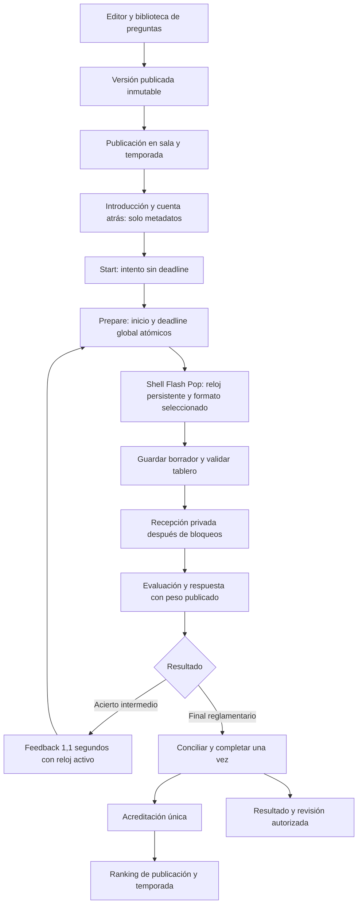

# Contrarreloj

Estado: vigente para Queens y Conectar parejas.

Última actualización: 2026-11-03. Identificador técnico: `time-trial`.

## Propósito y alcance

Resolver una secuencia fija de pruebas de un mismo formato antes de agotar un único reloj global. Cada tablero
resuelto concede su peso editorial completo y abre el siguiente. Cada desafío admite entre
2 y 20 pruebas: todas Queens de 4×4 a 8×8 o todas Conectar parejas cuadradas de 4×4 a 8×8,
con entre tres parejas y tantas como filas tenga cada tablero. Los tamaños pueden mezclarse
dentro de una secuencia de Conectar parejas; no se admiten secuencias con formatos mezclados.
Escape, Mini-Wordle y Hashtag quedan fuera
hasta verificar sus combinaciones de modo y formato.

Las [decisiones normativas](../../decisions/decisions.md#21-contrarreloj-reglas-acordadas), los
[contratos comunes](mode-contracts.md#reglas-comunes), el
[ADR de recuperación](../../decisions/adr/0003-attempt-lifecycle-and-concurrency.md) y el
[ADR de transferencia](../../decisions/adr/0006-explicit-attempt-control-transfer.md) prevalecen.
Las decisiones CT-01 a CT-05 están cerradas para esta versión; la
[guía editorial](../../content/guidelines/contrarreloj.md) define la calibración previa a publicar.

## Contenido, puntuación y oportunidades

Todos reciben las mismas versiones, el mismo orden y la misma duración. La dificultad debe crecer
por complejidad observada; puede aumentar reduciendo pistas sin cambiar el tamaño del tablero.
La duración es obligatoria, sin valor inicial: segundos enteros positivos, guardados en
`global_time_limit_ms`. El máximo representable es 2.147.483 segundos completos.

Cada prueba tiene un peso editorial entero positivo. Los pesos suman exactamente 100; reordenar
conserva el peso y guardar nunca redistribuye puntos. Un acierto concede todo el peso. No hay
bonus por velocidad ni penalización de puntos por validaciones incorrectas. Cada versión puede
activar el crédito parcial al agotar el tiempo mediante `modeConfig.queensTimeoutPartialCredit` o
`modeConfig.connectPairsTimeoutPartialCredit`, según el formato. La configuración vacía usa puntuación binaria.
Los tiempos individuales publicados en las preguntas no tienen efecto competitivo en este modo.

En Queens, dos validaciones completas incorrectas permiten continuar en ese tablero; la tercera termina la
partida. El contador se reinicia al avanzar. Las ediciones exploratorias y las solicitudes
inválidas, incompletas o repetidas con la misma clave no consumen oportunidades.

## Conectar parejas

Conectar todos los extremos iguales con caminos ortogonales, sin casillas repetidas ni solapamientos,
y cubrir todas las casillas resuelve el tablero. Cada cuadrícula es cuadrada y mide entre 4×4 y 8×8;
el número de parejas va de tres al lado del tablero. Borrar, recortar y rehacer rutas no consume oportunidades
ni puntos. La UI envía automáticamente el tablero completo; PostgreSQL valida las reglas públicas
antes de crear la recepción y acepta cualquier solución legal, aunque difiera de la editorial.
Una respuesta inválida o incompleta devuelve `invalid_connect_pairs_answer` (HTTP 422), sin consumir
la interacción; el tablero permanece editable con el reloj activo. No hay límite de errores ni cierre
por `validation_limit` en este formato. Las reglas de recuperación estricta se conservan.

## Checkpoints y revisión

Queens y Conectar parejas guardan checkpoints validados por el servidor en `attempts.progress_payload`
mientras la interacción siga abierta. El jugador puede continuar editando mientras se confirma un
guardado anterior; el checkpoint solo refleja el último estado aceptado por el servidor. Guardarlo no
crea una recepción ni equivale a validar el tablero.

Al cerrar por timeout o conciliar una evaluación pendiente sin respuesta, el servidor copia el último
checkpoint válido con progreso de la interacción a `attempt_answers.review_state` antes de limpiar el
progreso del intento. Al vencer el reloj, un checkpoint que resuelve el tablero según las reglas del
formato cuenta como `correct` y recibe todo su peso en cualquier versión de Contrarreloj. Si era el
último tablero, el intento termina como `all_solved`. Si quedaban más, termina como `time_limit`.

Si el checkpoint no resuelve el tablero y el parcial está desactivado, la respuesta queda como
`unanswered` con cero puntos. En Queens con el parcial activo, PostgreSQL compara
las coronas guardadas con la solución publicada, excluye las fijas y aplica
`min(peso − 1, floor(peso × aciertos propios / coronas por colocar))`. Con cero coronas por
colocar o sin aciertos propios, la puntuación es cero. En Conectar parejas con el parcial activo,
se toma el menor valor entre el peso menos uno y los dos productos redondeados hacia abajo
`peso × parejas conectadas / parejas totales` y
`peso × casillas de caminos completos / casillas totales`. Los caminos abiertos se muestran
en la revisión y aportan cero. Si acredita puntos, la respuesta queda como
`partial` y aporta al total y a la temporada sin contar como resuelta. Solo cuenta el último guardado
aceptado antes del límite. Una recepción aceptada a tiempo se evalúa con sus propias reglas y conserva
su resultado.

## Reloj y finalización

La introducción solo entrega metadatos y precarga controles. No crea intento ni libera tablero.
Tras los tres segundos de cuenta atrás, `start` valida la publicación y crea o recupera el intento
con `deadline_at = null`. La primera preparación crea atómicamente su unidad temporal, el deadline
y el intervalo antes de entregar el primer tablero. `started_at` conserva la fecha de creación;
el inicio competitivo se deriva de `deadline_at − global_time_limit_ms`.

Cada prueba tiene su intervalo y unidad temporal, con el mismo deadline global. La sesión conserva
ese vencimiento. El reloj corre durante validaciones, cargas y transiciones, sin compensaciones.
La transición de acierto dura 1,1 segundos; el último acierto solicita el cierre inmediatamente.

La recepción se fecha en PostgreSQL después de adquirir los bloqueos. Solo es válida si sucede
**antes** del deadline; la igualdad queda fuera. El cierre concilia primero cualquier recepción
pendiente. Una recepción aceptada a tiempo mantiene sus puntos aunque se evalúe después del límite:

| Hecho conciliado                                                    | Motivo de cierre       |
| ------------------------------------------------------------------- | ---------------------- |
| Resuelve la última prueba mediante recepción o checkpoint al vencer | `all_solved`           |
| Tercera validación completa incorrecta                              | `validation_limit`     |
| Acierto intermedio y reloj ya vencido                               | `time_limit`           |
| Prueba activa sin recepción final, recuperada antes del límite      | `recovery_interrupted` |
| Reloj vencido al recuperar con pruebas sin resolver                 | `time_limit`           |

Los cierres reglamentarios persisten `completed`, `outcome = null` y conservan los puntos anteriores.
Abandono y pérdida de permisos siguen las reglas comunes y no acreditan puntos. Finalización,
evaluación y ledger son idempotentes. No se fabrican respuestas o tiempos para pruebas no entregadas.

## Recuperación

Una recepción existente se concilia primero. Antes del vencimiento, recuperar una prueba activa sin
recepción final interrumpe el desafío y puede conservar el checkpoint para revisión, con cero puntos
en esa prueba. Después del vencimiento, la recuperación aplica el mismo cierre que el temporizador.
No se reentrega una prueba vista. La transferencia de control conserva el intento y deadline originales.

Un intento creado sin tablero puede recibir su primera prueba. Recuperar entre pruebas, sin una
interacción abierta ni recepción pendiente, permite preparar la siguiente si el reloj sigue vivo.
Recargar y perder una confirmación nunca crea un nuevo reloj ni una segunda acreditación.

## Rankings y revisión

El comparador central de publicación e historial ordena por pruebas resueltas descendente. En
versiones con parcial activo, el primer desempate es la puntuación del desafío, de mayor a menor.
El último criterio son los milisegundos globales hasta el último acierto, de menor a mayor. Las
recepciones aceptadas usan su hora efectiva. Los tableros resueltos a partir de un checkpoint de
timeout usan la hora del vencimiento. El tiempo incluye las transiciones y excluye el fallo final.
Los empates comparten
posición (`1, 1, 3`). Los jugadores sin tableros resueltos carecen de tiempo de último acierto.
El identificador del jugador estabiliza únicamente el orden visual. La temporada sigue sumando
Flash Points y no cambia su comparador.

La revisión distingue pruebas resueltas, entregadas sin resolver y no alcanzadas. Las últimas
muestran orden, formato y peso, sin tablero ni solución. Las consultas de resultado propio siguen
requiriendo autorización; las soluciones nunca aparecen durante el juego.

## Recorrido E2E



Se reutilizan versiones, publicaciones, intentos, sesiones, unidades temporales, intervalos,
recepciones, respuestas y ledger; no se añaden tablas. `private.time_trial_progress` deriva el
progreso independiente del formato. `get_my_time_trial_challenge` entrega metadatos y
`get_my_time_trial_result` entrega el resultado propio y revisión protegida. El dispatcher común,
los comandos competitivos y las rutas HTTP existentes integran el modo.

La UI reutiliza `ChallengeIntro`, `StartCountdown`, `FlashPopGameShell`, `ServerQueensQuestion`, `ConnectPairsQuestion`,
`Timer`, avisos de sesión, resultados y revisión. El reloj permanece montado durante la prueba,
validación, transición y preparación. Los controles desaparecen durante la confirmación final.
El resultado muestra puntos, resueltas/total, tiempo hasta el último acierto o «Sin aciertos» y motivo.

## Integración y publicación

La migración incremental conserva el historial aplicado y los cinco modos anteriores. Desplegar
primero la migración compatible y después la aplicación. Las suites SQL, unitarias, integración
Supabase y E2E aisladas cubren reglas, permisos y regresiones; la evidencia de cada ejecución se
registra en [estado del proyecto](../status.md).

Antes de habilitar publicaciones reales, resolver una secuencia del formato seleccionado calibrada en staging,
comprobar móvil/escritorio y revisión, y verificar soluciones, pistas, progresión y duración. Los
fixtures de pruebas validan contratos técnicos y no constituyen contenido editorial calibrado.

### Escenario local dedicado

`npm run supabase:fixture -- --scenario time-trial-connect-pairs` prepara una sala local independiente.
`npm run test:e2e:isolated -- e2e/time-trial-connect-pairs.spec.ts e2e/time-trial.spec.ts` comprueba
ambos formatos en un stack desechable. El escenario incluye dos tableros curados, 120 segundos globales
y pesos de 30 y 70 puntos; es contenido de prueba y no modifica los calendarios de BetaVIP o Tabarnia.
El setup habitual `npm run supabase:betavip:setup` también incluye «Circuito de parejas» como
primer desafío de BetaVIP: siete tableros 4×4, 4×4, 5×5, 5×5, 6×6, 6×6 y 7×7; 150 segundos y pesos
12, 13, 13, 14, 15, 16 y 17. Queens de BetaVIP y ambos Contrarreloj de Tabarnia comparten esta
secuencia de tamaños, duración y pesos. Cada uno empieza con un 4×4 fácil propio; los seis
tableros anteriores conservan sus diseños y orden relativo.

Para comprobar las cuatro secuencias con integración Supabase y navegador en un stack desechable:

```bash
E2E_INTEGRATION_SCENARIOS=betavip,tabarnia npm run test:e2e:isolated -- e2e/betavip.spec.ts e2e/tabarnia-time-trial.spec.ts
```

El ejecutor prepara las salas con sus seeds y restaura los manifiestos locales de ambas al finalizar.
Esta comprobación no actualiza publicaciones ni historiales de las bases existentes.

Las migraciones originales `20261016144218_time_trial_connect_pairs` y
`20261016193510_connect_pairs_variable_square_boards` añadieron el formato y sus tamaños actuales;
ambas forman parte de la [inicial activa](../../../supabase/migrations/20261103090247_initial_schema.sql).
Una instalación nueva debe aplicar esa inicial antes de desplegar la aplicación. Las bases con el
historial anterior deben seguir el procedimiento de
[adopción](../supabase-clean-installation.md#adoptar-el-historial-consolidado); esos IDs retirados
no se aplican individualmente.
